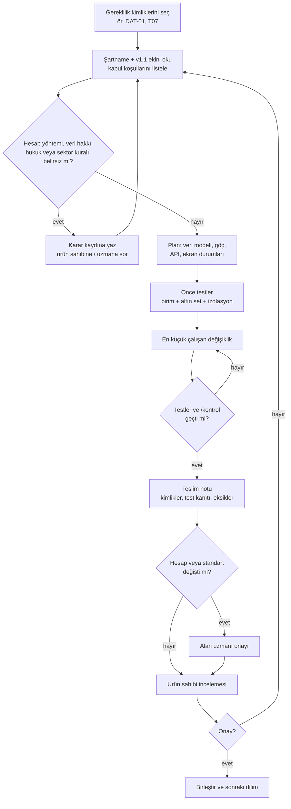
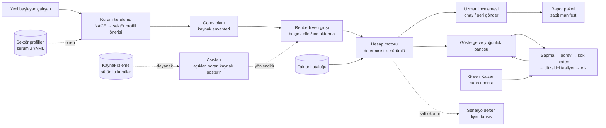

# Geliştirici iş akışı

İki şema: (1) her geliştirme diliminin döngüsü, (2) uygulamanın çalışma anındaki akışı. Şemalar Mermaid ile yazılmıştır; GitHub, GitLab ve çoğu Markdown görüntüleyicide çizilir. Aynı şemaların görsel hâli `docs/img/` altındadır.

## 1. Geliştirme döngüsü (her dilim)

## 2. Çalışma anı: kullanıcıdan rapora

Kesik çizgiler veri veya öneri akışıdır; asistan ve senaryo defteri hesap sonucunu değiştiremez.
